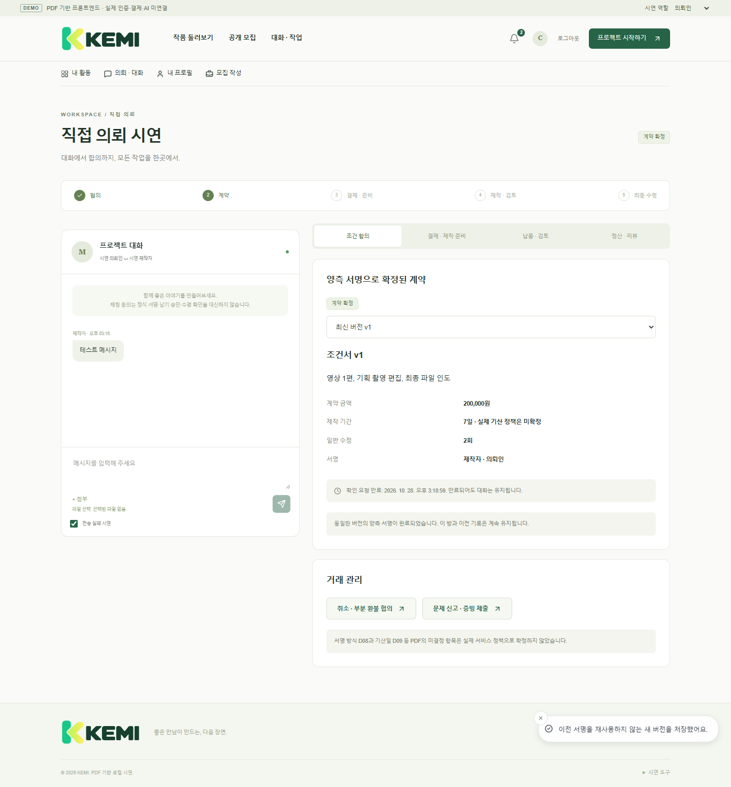

# PDF 기반 KEMI 프론트엔드 시연

사용자가 제공한 단계별 개발 계획 PDF만 기준으로 구현한 독립 실행 React/Vite 예제입니다. 기존 서비스의 프론트엔드·백엔드와 별개로 실행합니다.

```sh
cd examples/pdf-frontend
npm ci
npm run dev
```

접속: http://127.0.0.1:5173 (Node 24 / npm 11)

상단에서 의뢰인·제작자 시연 역할을 전환합니다. 작품 탐색·모집·제안·협의·양측 서명·제작 준비·버전별 납품·수정·수령·모의 정산·리뷰·취소/부분 환불·분쟁 화면을 조작할 수 있습니다.

**실제 인증, OAuth, PG 승인/환불, AI, 파일 업로드, 서버 권한 검증은 연결하지 않았습니다.** 역할은 시연용이며 실제 개인정보나 비밀번호를 입력하지 마세요. 파일명과 내장 샘플 영상으로 동작합니다. D01–D22의 미결정 정책을 확정한 구현이 아닙니다.

```sh
npm run test:pdf
npm run typecheck
npm run lint
npm run format:check
npm run build
```

로컬 상태 전이 테스트 20개와 Edge 브라우저 시나리오 16개를 검증했습니다. 실제 API·DB·PG·배포 검증과 구분합니다. 브라우저 검사는 실행 중인 서버와 별도로 설치된 Playwright 및 Microsoft Edge가 필요합니다. `KEMI_PLAYWRIGHT`(선택)와 `KEMI_URL`(선택)을 설정한 뒤 `node qa/pdf-frontend/browser.mjs`로 실행합니다.

- [상세 실행·시연·미연동 항목](docs/pdf-frontend-guide.md)
- [구현 계획과 범위](docs/pdf-frontend-plan.md)
- [브라우저 실행 결과](qa/pdf-frontend/browser-results.json)



기존 제공 KEMI 로고·디자인 토큰과 공통 UI를 재사용했습니다. 원본 표기 및 UI 라이선스는 `apps/web/src/design-tokens/README.md`, `apps/web/src/components/ui/LICENSE.md`에 보존했습니다. `public/demo.webm`은 직접 생성한 추상 애니메이션이며 고객 영상이 아닙니다.
